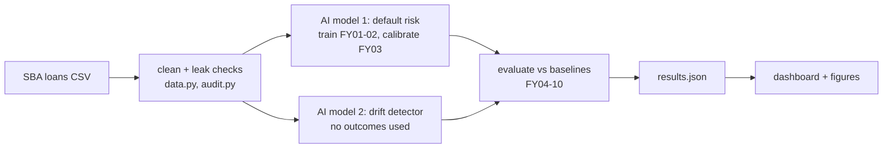

# Stale Model Alarm

**Track:** Finance
**Team:** Mihir Heera, Owen Garabedian

> This project is a prototype and is not financial advice.

**Main takeaway:** a bank's loan model can keep *ranking* borrowers well while badly *under-estimating* how many
will default. In 2005–07 a second AI, built only from application forms, flagged that the model needed review. It
used no repayment data and showed what had changed.

## The problem
Community banks score small-business loans with models trained on past loans. Whether a loan defaults only shows up
years later, so a model can quietly go out of date while the bank keeps trusting it. In FY2004–07 our test model
expected **$2.8B** of losses on SBA loans; **$5.7B** were actually charged off. That money comes from lenders and from
the taxpayer-backed SBA guarantee.

## What we built
A model-review tool for a **credit-risk analyst at a community bank**.
- **In:** a year's loan applications (amount, SBA guarantee share, employees, industry, state, ...).
- **Out:** a default risk for each loan (AI model 1), and a yearly **drift status** (AI model 2) saying whether
  applicants still look like the ones model 1 learned from, and *which* details changed.
- **[Interactive dashboard](https://mihirheera.github.io/stale-model-alarm/dashboard/index.html)** (live link; source in
  `dashboard/`): replay FY2004–2010 one year at a time. Each year shows a status
  (no drift / drift, model stable / drift, model deteriorated / too early to judge), the numbers, and two real
  example loans going in and a risk score coming out.
- It never approves or rejects a loan. It tells a person when to review the model.

## What we added
Our own idea, with our own question, data and test design. It is not one of the suggested projects.
- **Question:** can a credit model tell it has gone stale *before* loans fail? The usual project asks "can we
  predict default?"
- **Data:** 899,164 real SBA loans spanning the 2008 crisis, so the idea is tested against what actually happened.
- **Method:** a second AI (adversarial validation) audits the first. Its alarm threshold is set *only* from normal
  years.
- **Found and removed a leak:** the loan-term column pushes AUC to 0.96. We did not find it documented in the sources
  we checked.

## How it works
**Data.** SBA 7(a) loans, Li, Mickel & Taylor (2018), CC BY 4.0. Target: charged off (1) vs. paid in full (0).
Only approval-day information is used. Three problems were found and handled:
- **Term leak.** Round terms defaulted 0.8% and odd terms 29.6%, which is impossible for a contract fixed on day one,
  so Term was removed.
- **Unfinished loans missing.** The file only keeps loans finished by 2014, so we judge only FY2004–07 and use official
  SBA counts as a lower bound.
- **Industry codes.** They were missing for about half of the loans before FY2001, so training starts in FY2001.

**Model 1 (default risk).** Gradient boosting trained on FY2001–02 (81,624 loans), calibrated on FY2003, tested on
FY2004–10. **Baselines:** the average default rate for everyone; an industry lookup table. Logistic regression is
the comparison.

**Model 2 (drift).** For each year, a classifier tries to tell that year's applications from FY2001–03 ones, with no
outcomes. Its AUC is the drift score. The alarm fires above the most that normal years differed from each other (0.695).
**Baselines:** PSI, the banking industry's standard drift check, and a "label monitor" that counts early defaults.

## Results
Every number is on years the models never trained on; 95% bootstrap intervals are in `results/results.json`.

| Year | Actual default | Model expected | AUC: model / industry rule / average | Precision / recall | Drift score (alarm > 0.695) |
|---|---|---|---|---|---|
| FY2004 | 18.0% | 14.9% | 0.664 / 0.543 / 0.5 | 0.26 / 0.58 | 0.677 – |
| FY2005 | 25.3% | 16.4% | 0.640 / 0.536 / 0.5 | 0.33 / 0.61 | 0.816 **alarm** |
| FY2006 | 35.0% | 16.9% | 0.626 / 0.530 / 0.5 | 0.43 / 0.60 | 0.889 **alarm** |
| FY2007 | 42.8% (≥ 30.8%*) | 17.5% | 0.618 / 0.525 / 0.5 | 0.51 / 0.61 | 0.915 **alarm** |

\*Lower bound assuming every loan missing from the file was repaid (official count: 99,603 approvals).

- **Model 1 beat both baselines in every judged year** on AUC, PR-AUC and Brier score. It caught about as many
  defaults as the industry rule while flagging fewer loans (39–52% vs. 57–58%). But its risk estimates
  collapsed: by FY2007, 2.4× as many loans defaulted as it expected.
- **Model 2's alarm was on for all three years the model had deteriorated (FY2005–07)** and off in FY2004. It still
  fired with recording-sensitive fields removed and with alarm margins from 0 to 0.10. Top drivers: SBA guarantee
  share, credit-line coding, the end of the LowDoc program, loan size.

**Where it fails**
- **One loan it got wrong** (picked by a fixed rule: the median-risk FY2006 default it missed): a $165,000 franchise
  loan with a 75% guarantee. The model gave it 12.6% risk, below its 17.0% cut-off, and the loan was charged off.
  Loans like it defaulted 11.8% in training and 30.4% in FY2006. The model applied a lesson that had stopped being
  true.
- **No lead time.** The simple label monitor also first fired in FY2005, so the alarm was *as fast as* counting early
  defaults, not faster. Its advantages are that it needs no outcomes and explains what changed.
- **False alarms and misses.** It gave 1 false alarm in 3 among normal years, and missed FY2004's mild under-estimate
  (1.21×). It misses about 4 in 10 defaults every year. By FY2010 it was no better than the industry rule (AUC 0.50
  vs. 0.55).
- **Drift is not failure.** Drift keeps rising in FY2009–10 while default rates fall. Some drift is SBA program
  changes, not riskier borrowers.
- **Group gaps.** Florida loans defaulted at 2.69× the expected rate, Ohio 1.36×. There are no demographic fields, so
  this is not a protected-group fairness audit. It is one crisis, in US data only.

Full details, the dollar table, the precision/recall table and all failure cases are in the
[full write-up](docs/full_writeup.md).

## What we'd do next
1. Run the same test on the SBA's newer data (FY2010–present, including COVID) to see if the alarm ever gives real
   lead time.
2. Test whether *recalibrating* the model when the alarm fires closes the gap between expected and actual losses.

## Sources
- Data: Li, M., Mickel, A., & Taylor, S. (2018). "Should This Loan be Approved or Denied?" *Journal of Statistics
  Education* 26(1). https://doi.org/10.1080/10691898.2018.1434342 (CC BY 4.0); Kaggle mirror:
  https://www.kaggle.com/datasets/mirbektoktogaraev/should-this-loan-be-approved-or-denied
- Official approval counts: U.S. SBA "Table 3 – Number of Approved Loans by Program",
  https://webharvest.gov/congress115th/20181203195802/https://www.sba.gov/sites/default/files/WDS_Table3_ApprovalCount_Report.pdf
- Methods: adversarial validation / classifier two-sample tests (Lopez-Paz & Oquab, ICLR 2017); PSI (credit-risk
  practice).
- Libraries: pandas, NumPy, scikit-learn, matplotlib, kagglehub, pytest, Chart.js.
- AI tools: **Claude Code (Anthropic; Claude Opus 5.5 and Sonnet 5.5)** helped research the idea, write the code, run
  the analysis and draft documentation. No pretrained models are used.

---

## Appendix: how it's built and how to reproduce it

```bash
pip install -r requirements.txt
cd src
python -m sma.audit          # data checks: Term audit, outcome maturity  -> results/audit.json
python -m sma.pipeline       # experiments E4-E10 (~3 min on a laptop)   -> results/results.json
python -m sma.figures        # figures                                    -> results/figures/
cd .. && python dashboard/build_dashboard.py   # -> dashboard/index.html (open in a browser)
pytest -q                    # 13 checks: cleaning, leakage guards, PSI, metrics, dollar maths, examples
```
The data downloads automatically from Kaggle via `kagglehub`; or set `SMA_DATA_PATH=/path/to/SBAnational.csv`.
Every number in this README and the dashboard comes from `results/results.json`, which is generated by the code.

| Folder | What's in it |
|---|---|
| `src/sma/` | `data.py` cleaning · `models.py` AI model 1 + baselines · `drift.py` AI model 2 + PSI · `evaluate.py` metrics · `pipeline.py` experiments · `audit.py` data checks |
| `results/` | every number and figure, generated by the code |
| `dashboard/` | interactive demo |
| `docs/` | [full write-up](docs/full_writeup.md), [feature audit](docs/feature_audit.md), [decision log](docs/decision_log.md), [technical guide](docs/technical_guide.md), [judge Q&A](docs/judge_qa.md), [demo script](docs/demo_script.md), [rubric mapping](docs/rubric_mapping.md) |
