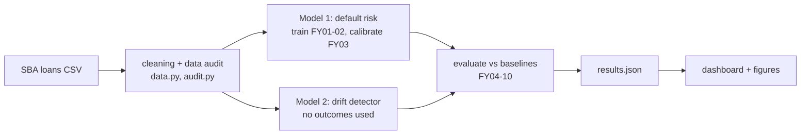

# Stale Model Alarm

**Track:** Finance
**Team:** Mihir Heera

> This project is a prototype and is not financial advice.

**[Live dashboard](https://mihirheera.github.io/stale-model-alarm/dashboard/index.html)** · [Full write-up](docs/full_writeup.md) · [Judge Q&A](docs/judge_qa.md)

**Main takeaway:** in a retrospective test on SBA small-business loans, a credit-risk model kept *ranking* borrowers
better than simple rules while badly *under-estimating* how many would default. A second model, which looks only at
application forms, flagged those same years. It was not earlier than a simple default count. What it adds is that it
needs no repayment data and shows which applicant characteristics changed.

## The problem
Community banks score small-business loans with models trained on past loans. Whether a loan defaults only becomes
known years later: in the FY1995–2000 cohorts, only 68% of eventual charge-offs happened within seven years. So a model
can go out of date while the bank still trusts it. In FY2004–07, the test model's probabilities implied about **$2.8B**
of charge-offs; **$5.7B** of principal was recorded as charged off. These are gross charge-offs, before any
recoveries and shared between lenders and the SBA guarantee, so they are not final losses.

## What we built
A model-review aid for a **credit-risk analyst at a community bank**. It is a retrospective research prototype, not a
deployed bank system.
- **In:** a year's loan applications (amount, SBA guarantee share, employees, industry, state, ...).
- **Out:** a default probability for each loan (Model 1), and a yearly **drift status** (Model 2) saying whether
  applicants still resemble the ones the risk model was built from, and which details changed.
- **[Dashboard](https://mihirheera.github.io/stale-model-alarm/dashboard/index.html)** (source in `dashboard/`): replays
  FY2004–2010 one year at a time, with the status, the evidence behind it, real example loans and suggested analyst actions.
- It never approves or rejects a loan. It gives a person a reason to review the model.

## What we added
Our own idea; not one of the suggested projects.
- **Question.** Not "can we predict default?" but "can a credit model's owner tell it is going stale *without waiting
  for loans to fail*?"
- **Two-model design.** A second classifier (adversarial validation) monitors the first, using application details only.
- **Chronological test against two kinds of baseline.** Prediction baselines for Model 1 (average rate, industry
  lookup) and monitoring baselines for Model 2 (PSI, a simple default count).
- **A suspicious field found and removed.** The loan-term column lifts AUC to about 0.96. We did not find this
  documented in the sources we checked.

## How it works
**Four ideas kept separate throughout:** *drift* (applicants changed; inputs only), *discrimination* (does the model
rank risky loans above safe ones; AUC), *calibration* (do predicted percentages match what happened) and *realised
defaults* (the outcome, known years later).

**Data.** 899,164 SBA 7(a) loans, Li, Mickel & Taylor (2018), CC BY 4.0. Target: charged off (1) vs. paid in full (0).
Only details available on approval day are used ([feature audit](docs/feature_audit.md)). Three data problems:
- **Loan term: suspected outcome contamination.** In mature cohorts, round terms (multiples of 12 months) defaulted 0.8%
  and odd terms 29.6%; 84-month loans 0.3%, 83-month loans 10.3%. We could not establish the mechanism (the recorded
  term does not match time to charge-off), so this is a suspected recording problem, not proven leakage. Term is excluded as a
  precaution.
- **Incomplete outcomes.** The file only keeps loans resolved by 2014, so later cohorts over-state default rates. Only
  FY2004–07 are judged; FY2008–10 are shown as outcome-incomplete.
- **Recording changes.** Industry codes are missing for about half of loans before FY2001, so nothing earlier is used.

**Model 1 (default risk).** Gradient boosting trained on FY2001–02 (81,624 loans), calibrated on FY2003, tested on
FY2004–10. Baselines, fitted on the same training years: the average default rate for everyone, and an industry
lookup table. *Why gradient boosting:* a strong, standard choice for tables mixing numbers and categories, fast to
train, easy to inspect. The question here is monitoring, not maximum accuracy.

**Model 2 (drift).** For each year, a classifier tries to tell that year's applications from FY2001–03 ones, with no
repayment outcomes. Its held-out AUC is the drift score: 0.5 means indistinguishable. *Why adversarial validation:*
PSI checks one detail at a time; this looks at all of them together. *Why FY2001–03 when Model 1 trains on FY2001–02:*
the finished model was built from all three years (calibrated on FY2003). Baselines: PSI (the banking industry's
standard check) and a "label monitor" that counts defaults already seen among loans approved two years earlier.

**Alarm threshold (preliminary).** Each reference year was scored against the other two: FY2001 0.671, FY2002 0.586,
FY2003 0.695. The threshold is the largest, **0.695**, fixed before any later year was examined.

## Results
All figures are for years never used in training or calibration; 95% bootstrap intervals are in `results/results.json`.

| Year | Observed default | Model predicted | AUC: model / industry rule / average | Precision / recall | Drift score (alarm > 0.695) |
|---|---|---|---|---|---|
| FY2004 | 18.0% | 14.9% | 0.664 / 0.543 / 0.5 | 0.26 / 0.58 | 0.677 – |
| FY2005 | 25.3% | 16.4% | 0.640 / 0.536 / 0.5 | 0.33 / 0.61 | 0.816 **alarm** |
| FY2006 | 35.0% | 16.9% | 0.626 / 0.530 / 0.5 | 0.43 / 0.60 | 0.889 **alarm** |
| FY2007 | 42.8% (≥ 30.8%*) | 17.5% | 0.618 / 0.525 / 0.5 | 0.51 / 0.61 | 0.915 **alarm** |

\*42.8% is among the 71,649 FY2007 loans in the file. If every FY2007 loan missing from the file (official count:
99,603 approvals) was repaid, the rate would be 30.8%. The true figure lies between the two.

- **Model 1 beat both prediction baselines** on AUC, PR-AUC and Brier score in each of FY2004–07, with higher precision
  than the industry rule. Its recall was slightly lower in FY2004–06 (0.58–0.60 vs. 0.62–0.63) because it flagged fewer
  loans (39–52% vs. 57–58%).
- **Discrimination held; calibration failed.** AUC fell only from 0.68 (FY2003) to 0.62, but by FY2007 2.4× as many
  loans defaulted as predicted.
- **Model 2's alarm was on in FY2005–07**, the three judged years in which Model 1 deteriorated, and off in FY2004. It
  stayed on with recording-sensitive fields removed. Largest contributors: SBA guarantee share, credit-line coding, the
  end of the LowDoc program, loan size. Part of this is program and coding change, not riskier borrowers.
- **The monitoring baselines did as well on timing.** PSI and the label monitor both also first fired in FY2005.

**Where it fails**
- **No earlier warning shown.** The label monitor (two-year lag) fired in the same first year. With a three-year lag it
  first fires in FY2006, but we report the stricter comparison. The drift detector's advantage is that it needs no
  outcomes and points to what changed.
- **The threshold rests on three reference years.** That is too few to estimate a false-alarm rate. FY2003, the most
  unusual of the three, sets the line; had it been left out, FY2003 itself would have been flagged. FY2004 scored 0.677
  (0.677–0.694 under three other random seeds), just under 0.695, so its "no alarm" is a close call.
- **Mild under-prediction went unflagged.** FY2004 had 1.21× the predicted defaults. Under our rule (more than 1.25×)
  that is not deterioration; under a stricter rule it would be a miss.
- **One loan it got wrong** (fixed rule: the median-risk FY2006 default it did not flag): a $165,000 franchise loan with
  a 75% guarantee, scored 12.6%, below the 17.0% cut-off; it was charged off. Loans with that guarantee defaulted 11.8%
  in training and 30.4% in FY2006.
- **Modest and decaying.** Model 1 misses about 4 in 10 defaults every year. In FY2010 (outcome-incomplete) its AUC was
  0.50 against 0.55 for the industry rule.
- **Drift is not risk.** Drift scores keep rising in FY2009–10 while recorded default rates fall.
- **Group gaps, descriptive only.** FY2004–07 defaults were 2.69× predicted in Florida (17,547 loans) and 1.36× in
  Ohio (11,692). Region is confounded with the housing market, and the data has no demographic fields: this is not a
  protected-group fairness audit.
- **One dataset, in hindsight.** US SBA loans approved before one downturn. It is not evidence of how the method
  would perform at a real bank.

More detail: [full write-up](docs/full_writeup.md) (dollar table, precision/recall table, robustness checks).

## What we'd do next
1. Repeat the test on the SBA's newer loan-level data (FY2010–present, including COVID) to learn whether the alarm ever
   leads outcome-based monitoring, and to estimate a false-alarm rate from more normal years.
2. Test whether recalibrating Model 1 when the alarm fires narrows the gap between predicted and observed defaults.

## Sources
- Data: Li, M., Mickel, A., & Taylor, S. (2018). "Should This Loan be Approved or Denied?" *Journal of Statistics
  Education* 26(1). https://doi.org/10.1080/10691898.2018.1434342 (CC BY 4.0); Kaggle mirror:
  https://www.kaggle.com/datasets/mirbektoktogaraev/should-this-loan-be-approved-or-denied
- Official approval counts: U.S. SBA "Table 3 – Number of Approved Loans by Program",
  https://webharvest.gov/congress115th/20181203195802/https://www.sba.gov/sites/default/files/WDS_Table3_ApprovalCount_Report.pdf
- Methods: adversarial validation / classifier two-sample tests (Lopez-Paz & Oquab, ICLR 2017); PSI (credit-risk
  practice).
- Libraries: pandas, NumPy, scikit-learn, matplotlib, kagglehub, pytest, Chart.js.
- AI tools: **Claude Code (Anthropic; Claude Opus 5.5, Sonnet 5.5 and Fable 5.2)** helped develop and research the
  idea, wrote the code, ran the analysis, and drafted the documentation and dashboard, under my
  direction and review. No pretrained models are used.

---

## Technical appendix: how it's built and how to reproduce it

```bash
pip install -r requirements.txt
cd src
python -m sma.audit          # data checks: Term audit, outcome maturity  -> results/audit.json
python -m sma.pipeline       # experiments E4-E10 (~3 min on a laptop)   -> results/results.json
python -m sma.figures        # figures                                    -> results/figures/
cd .. && python dashboard/build_dashboard.py   # -> dashboard/index.html (open in a browser)
pytest -q                    # 13 checks: cleaning, leakage guards, PSI, metrics, dollar maths, examples
```
The data downloads from the public Kaggle mirror via `kagglehub` (no login was needed when this was written). If that
fails, download `SBAnational.csv` from the Kaggle page and set `SMA_DATA_PATH=/path/to/SBAnational.csv`.
Results are deterministic (fixed seed 42): a clean clone reproduces `results/results.json` exactly.

| Detail | Value |
|---|---|
| Features (13) | loan amount (log), SBA guarantee share, employees, jobs created, jobs retained (log), new/existing, franchise, urban/rural, revolving-credit flag, LowDoc flag, 2-digit industry, state, bank in same state |
| Model 1 | scikit-learn `HistGradientBoostingClassifier` (300 trees, learning rate 0.08), isotonic calibration on FY2003; flag cut-off (17.0%) maximises F1 on FY2003 |
| Model 2 | `HistGradientBoostingClassifier` on 15,000 applications per side, 40% held out; feature contributions by permutation importance |
| "Deteriorated" | observed ÷ predicted defaults above 1.25, or AUC more than 0.05 below FY2003 (judged years only) |
| Label monitor | share of loans approved two years earlier already charged off, vs. the highest such share for the FY1998–2000 cohorts |
| Dollar figure | Σ probability × approved amount × 57% (charged-off share of defaulted training loans), vs. Σ recorded charged-off principal |

| Folder | What's in it |
|---|---|
| `src/sma/` | `data.py` cleaning · `models.py` Model 1 + baselines · `drift.py` Model 2 + PSI · `evaluate.py` metrics · `pipeline.py` experiments · `audit.py` data checks |
| `results/` | every number and figure, generated by the code |
| `dashboard/` | interactive dashboard (`template.html` + `build_dashboard.py` → `index.html`) |
| `docs/` | [full write-up](docs/full_writeup.md), [feature audit](docs/feature_audit.md), [decision log](docs/decision_log.md), [technical guide](docs/technical_guide.md), [judge Q&A](docs/judge_qa.md), [demo script](docs/demo_script.md), [rubric mapping](docs/rubric_mapping.md) |
