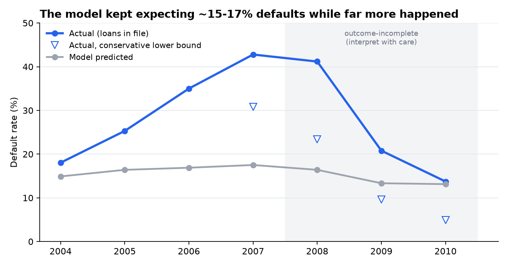

# Stale Model Alarm: full write-up

*The one-page version is the [README](../README.md). This page has every detail behind it.*

**Track:** Finance
**Team:** [your name(s) here]

> This project is a prototype and is not financial advice.

## The problem
Community banks score small-business loan applications with models trained on past loans. But a loan's outcome
only shows up years later. So a model can pass every check its owner can run, while the borrowers it is scoring today
no longer look like the ones it learned from. Underestimated risk means unexpected losses for the bank. It can also
mean small businesses get loans priced for a world that no longer exists.

## What we built
A monitoring tool for a **credit-risk analyst at a community bank** doing a periodic model review.
- **In:** one year's small-business loan applications (loan size, SBA guarantee share, employees, industry, state, ...).
- **Out:** (1) a default-risk score for each loan, from AI model #1; and (2) a **drift status** for the year, from AI
  model #2, which asks whether this year's applicants still look like the ones the risk model learned from. It also explains
  *which* application details changed.
- An interactive dashboard (`dashboard/index.html`) replays FY2004–2010 one year at a time. It shows four states:
  no drift / drift but performance stable / drift and performance deteriorated / not enough outcome data to judge.
- It never approves or rejects a loan. It tells a person when to review the model.

## What we added
Our own idea. It is related to the brief's loan-model project (4.2.3), but it asks a different question: *can a credit
model tell when it has gone stale, without waiting for loans to fail?* It uses its own dataset: 899,164 public SBA
loans.

## How it works
**Data.** SBA 7(a) loans from Li, Mickel & Taylor (2018), *Journal of Statistics Education* (CC BY 4.0), 899,164 loans
with 27 columns. Target: charged off (1) vs. paid in full (0). The 1,997 loans with no status were excluded, never
treated as repaid. Only information known on approval day is used ([feature audit](feature_audit.md)). Every
choice is in the [decision log](decision_log.md).

**Data problems we found and handled.**
1. **A hidden leak.** In fully matured loans, a "round" loan term (a multiple of 12 months) defaulted 0.8% of the time
   and an "odd" term 29.6%. A contract length set on approval day can't plausibly do that, so `Term` was removed. With it,
   AUC is about 0.96; without it, about 0.64.
2. **Missing unfinished loans.** The file only includes loans whose outcome was known by 2014, so recent cohorts look
   worse than they were. We judge only FY2004–2007, which have at least 7 years of follow-up. We also use official SBA
   approval counts as a conservative check.
3. **Recording changes.** The industry code was missing for 41–57% of loans before FY2001, so training starts in FY2001.

**AI model #1, default risk.** Gradient boosting (scikit-learn) trained on FY2001–2002 (81,624 loans). FY2003 is used
only to calibrate probabilities and pick the flagging threshold. Logistic regression is the interpretable comparison.
**Baselines:** predict the average rate for everyone, and an industry lookup table.

**AI model #2, drift detector (adversarial validation).** For each year, a second gradient-boosting classifier is shown
FY2001–2003 applications and that year's applications, with **no repayment outcomes**, and must tell them apart. Its
held-out AUC is the drift score. The alarm threshold is the largest drift seen *between the normal years themselves*,
so no crisis data was used to set it. **Baselines:** the industry-standard Population Stability Index (PSI > 0.25), and
a label-based monitor that watches how many loans from two years earlier have already defaulted.

## Results
All numbers are on years the models never trained on. Main model = gradient boosting. 95% bootstrap intervals are in
`results/results.json`.

| Approval year | Loans | Actual default | Model expected | Actual ÷ expected | AUC | Brier (model / avg-rate baseline) | Drift score (alarm > 0.695) |
|---|---|---|---|---|---|---|---|
| FY2004 | 68,195 | 18.0% | 14.9% | 1.21 | 0.664 | 0.141 / 0.152 | 0.677 – |
| FY2005 | 76,958 | 25.3% | 16.4% | 1.54 | 0.640 | 0.189 / 0.207 | 0.816 **alarm** |
| FY2006 | 75,756 | 35.0% | 16.9% | 2.07 | 0.626 | 0.251 / 0.281 | 0.889 **alarm** |
| FY2007 | 71,649 | 42.8% (≥ 30.8%*) | 17.5% | 2.44 | 0.618 | 0.299 / 0.341 | 0.915 **alarm** |

\*Lower bound assuming every loan missing from the file was repaid (official count: 99,603 approvals).

**What we found**
- **The model beat both baselines in every judged year (FY2004–07).** AUC was 0.62–0.66, vs. 0.53–0.54 for the
  industry rule and 0.50 for the average-rate baseline. Its Brier score was lower than both baselines in each of these
  years. *Exception:* in FY2010 (outcome-incomplete) its AUC fell to 0.50 and it did worse than the industry rule (0.55).
- **Its ranking held up, but its risk estimates collapsed.** AUC fell only from 0.68 (validation) to 0.62. But it
  expected 15–17.5% defaults while 18–43% happened. Even under the conservative bound, FY2007 had ≥1.8× the expected
  defaults. **A model can sort borrowers correctly and still badly misjudge how much risk the bank is taking.**
- **The drift alarm fired for all 3 deteriorated years (FY2005–07), with no false alarm in FY2004.** It still fired
  when recording-sensitive fields were removed, and for every alarm margin from 0 to 0.10.
- **What changed:** mainly the SBA guarantee share, revolving-credit coding, the end of the LowDoc program, and loan
  size. These are partly **program-mix and coding changes**, not just riskier borrowers.

**Precision and recall (the track asks for these).** The flagging cut-off (17.0% predicted risk) was chosen on FY2003.

| Year | Model: precision / recall / share of loans flagged | Industry rule: precision / recall / flagged | PR-AUC model / rule / average-rate |
|---|---|---|---|
| FY2004 | 0.26 / 0.58 / 39% | 0.20 / 0.63 / 57% | 0.286 / 0.199 / 0.180 |
| FY2005 | 0.33 / 0.61 / 46% | 0.27 / 0.62 / 58% | 0.349 / 0.272 / 0.253 |
| FY2006 | 0.43 / 0.60 / 49% | 0.37 / 0.62 / 58% | 0.439 / 0.366 / 0.350 |
| FY2007 | 0.51 / 0.61 / 52% | 0.44 / 0.59 / 57% | 0.508 / 0.442 / 0.428 |

The model catches about as many defaults as the industry rule while flagging far fewer good loans. It still misses
about 4 in 10 defaults every year.

**Financial impact (E9).** We turned the model's probabilities into dollars: P(default) × loan amount × the share of a
defaulted loan that was charged off in the training years (57%). Then we compared that with what was actually charged off.

| Year | Lent | Model-implied charge-offs | Actually charged off | Ratio | Lender's own (unguaranteed) share: implied → actual |
|---|---|---|---|---|---|
| FY2003 (calibration year, check) | $10.0B | $639M | $523M | 0.82 | $180M → $155M |
| FY2004 | $11.4B | $728M | $737M | 1.01 | $218M → $240M |
| FY2005 | $11.6B | $760M | $1,202M | 1.58 | $249M → $417M |
| FY2006 | $10.1B | $674M | $1,739M | 2.58 | $230M → $609M |
| FY2007 | $8.8B | $598M | $1,983M | 3.32 | $211M → $700M |

Across FY2004–07, the model implied **$2.76B** of charge-offs on $41.9B of loans, while **$5.66B** was charged off.
Lenders' own share was about $0.91B expected vs. $1.97B actual; the SBA guarantee, which is taxpayer money, covered
the rest. In the calibration year the same method *over*-estimated losses (0.82×), so it is not biased toward finding a gap.
In FY2004 the dollar estimate was on target (1.01×). Caveats: later years are overstated because the file is missing
loans still running in 2014, and the lender share uses each loan's guarantee percentage as an approximation.

**One loan the model got wrong (E10).** Chosen by a fixed rule, not by hand: among all FY2006 defaults the model did
not flag (10,613 of 26,517), the one with the median predicted risk. A new franchise business in "other services" in
Massachusetts borrowed $165,000 with a 75% SBA guarantee and 3 employees. The model gave it **12.6%** risk, below the
17.0% cut-off, so it was not flagged. It was charged off. *Why we think so:* in 2001–02, loans with a 75% guarantee
defaulted 11.8% of the time, the same as average. In FY2006 the same kind of loan defaulted 30.4%, while the model
expected 14.8%. The model ranked this loan by a lesson that had stopped being true. The pattern is broad: 72% of
FY2006's missed defaults had a 50% guarantee, matching their 71% share of all loans. These loans went from 31% of
training loans (12.6% default) to 71% of FY2006 loans (37.0% default, while the model expected 18.0%). The model
wasn't wrong about one group; it under-rated almost everyone. The dashboard shows the same rule's examples for every year.

**Where it fails, and what we can't claim**
- **No lead time.** The simple label-based monitor also first fired in FY2005. In this data, the drift alarm was *as
  fast as* waiting for early defaults, not faster. Its advantages are that it needs no outcome data and that it explains
  what changed. That is retrospective monitoring evidence, not a proven early warning.
- **False alarms are possible.** Among the three normal years, FY2003 was more different from the other two than they
  were from each other, so a leave-one-out check gives 1 false alarm in 3.
- **Missed mild deterioration.** FY2004 had 21% more defaults than expected, and the alarm stayed quiet. Under a stricter
  "deteriorated" rule (>10% more than expected), that counts as a miss.
- **Drift is not failure.** The drift score keeps rising in FY2009–10 while (incomplete) default rates fall.
- **Group check (FY2004–07).** Under-prediction hit every group we could check, but unevenly. Florida loans defaulted at
  2.69× the expected rate and Ohio at 1.36×. In professional services and health care, the model flagged only 26% and
  15% of the loans that defaulted. The data has no demographic fields, so **this is not a protected-group fairness
  audit**.
- **One crisis.** This is a case study of one downturn, using US SBA loans only.

## What we'd do next
1. Test the same alarm on the SBA's newer loan-level data (FY2010–present, data.sba.gov), including the COVID shock, to
   see if it ever gives real lead time.
2. Add economic indicators (e.g. state unemployment from FRED) and test whether *recalibrating* the model when the alarm
   fires reduces the gap between expected and actual defaults.

## Sources
- Data: Li, M., Mickel, A., & Taylor, S. (2018). "Should This Loan be Approved or Denied?" *Journal of Statistics
  Education* 26(1), 55–66. https://doi.org/10.1080/10691898.2018.1434342 (CC BY 4.0). Kaggle mirror:
  https://www.kaggle.com/datasets/mirbektoktogaraev/should-this-loan-be-approved-or-denied
- Official approval counts: U.S. SBA, "Table 3 – Number of Approved Loans by Program" (archived at
  https://webharvest.gov/congress115th/20181203195802/https://www.sba.gov/sites/default/files/WDS_Table3_ApprovalCount_Report.pdf)
- Libraries: pandas, NumPy, scikit-learn, matplotlib, kagglehub, pytest; Chart.js (dashboard).
- Methods: adversarial validation / classifier two-sample tests (Lopez-Paz & Oquab, ICLR 2017); Population Stability
  Index (credit-risk industry practice).
- AI tools: **Claude Code (Anthropic, Claude Opus 5.5 / Sonnet 5.5)** helped research the idea, write the code, run the
  analysis and draft documentation. No pretrained models are used.

